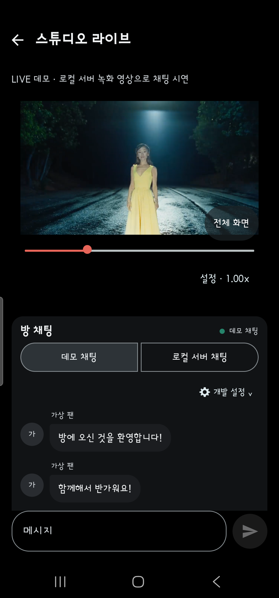
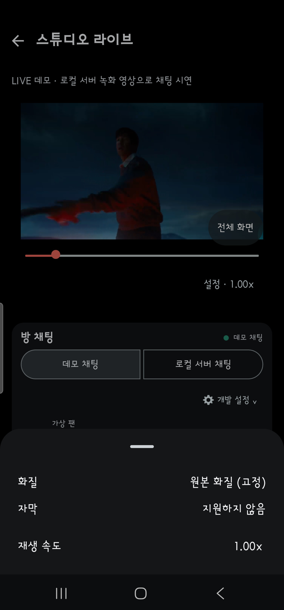
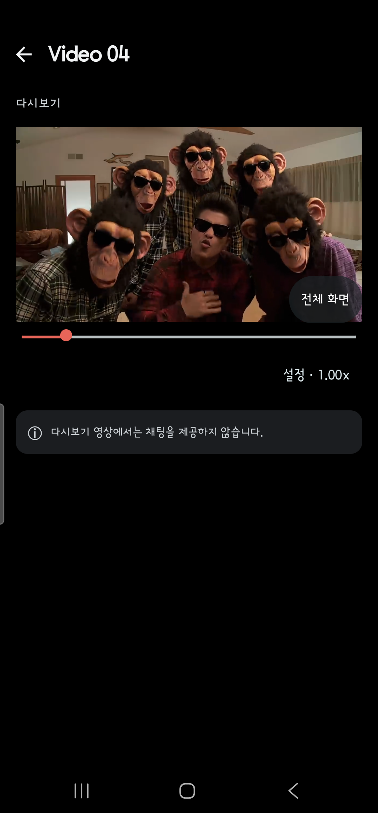
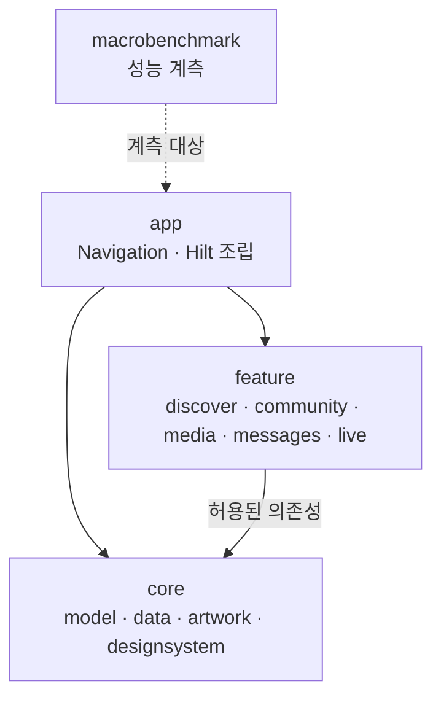

# FanStage

**Android Native 미디어·실시간 채팅 포트폴리오 | Kotlin · Jetpack Compose · Media3**

FanStage는 팬 커뮤니티를 소재로 만든 Android 앱입니다. Media3 기반 영상 재생과 WebSocket 채팅을 하나의 화면에서 다루며, **플레이어 생명주기·메시지 정합성·재연결·회귀 검증**에 집중했습니다. Discover, Community, Media, Messages, LIVE 화면을 Kotlin·Compose 멀티모듈 구조로 구성했습니다.

**프로젝트 및 담당 범위:** 개인 개발 프로젝트(2026년 11월). 요구사항·설계 기준과 수용 조건 정의, 아키텍처 선택·코드 리뷰, 기기·자동화 검증 및 변경 수용을 담당했습니다. **Codex는 코드 작성·수정 도구**로 사용했으며, 검증 통과 여부는 실행 결과와 PR 증거로 확인했습니다.

**주요 기술:** Kotlin · Compose · Coroutines/Flow · MVVM/UDF · Hilt · Media3 ExoPlayer · WebSocket/HTTP · Spring Boot · PostgreSQL · GitHub Actions · Codex

## 핵심 화면과 시연

| LIVE · 채팅 | 영상 재생 설정 |
|:--:|:--:|
|  |  |
| Media 화면 | Replay 플레이어 |
|  |  |

**시연 영상:** [영상 재생·설정 (16초)](docs/portfolio/media/physical-20261108/playback.mp4) · [앱 화면 탐색 (13초)](docs/portfolio/media/physical-20261108/navigation.mp4)

**서버 없이 재현하는 경로 (Debug 앱)**

1. 앱 실행 → 하단 **Media** 탭 선택
2. 목록에서 **Synthetic HLS** 카드 선택
3. **Replay** 화면에서 앱에 포함된 합성 HLS 영상을 재생하고 플레이어 조작·전체 화면을 확인

영상 재생은 앱 내 HLS VOD로 확인할 수 있습니다. LIVE 상세 화면의 영상은 개발용 로컬 MP4를 사용하며, 채팅은 기본 Fake 모드 또는 로컬 WebSocket 서버 연결을 선택할 수 있습니다. 재생 소스별 시연 방법은 [Android 실행 안내](android/README.md#시연-경로)에 정리했습니다.

## 주요 기술 문제와 해결

### 1. ACK가 유실된 채팅 메시지는 어떻게 처리할까?

**문제:** 서버에 저장된 메시지라도 ACK가 유실되면 클라이언트는 전송 결과를 알 수 없습니다. 이때 타임아웃을 곧바로 실패로 확정하거나 새 메시지 ID를 발급하면 중복 전송·표시로 이어질 수 있습니다.

**설계 판단:** 결과가 불확실한 동안 Pending을 유지하고, 재시도 시 동일한 `clientMessageId`를 사용하도록 했습니다. 서버에서는 멱등 키로 중복 저장·방송을 방지합니다. 클라이언트는 `serverSequence`를 기준으로 WebSocket 이벤트와 HTTP 조회 결과를 합쳐 순서·누락을 복구합니다.

**구현·검증:** [채팅 상태 처리](android/feature/live/src/main/kotlin/dev/fanstage/android/feature/live/chat/ChatViewModel.kt) · [재전송 단위 테스트](android/feature/live/src/test/kotlin/dev/fanstage/android/feature/live/chat/ChatViewModelTest.kt) · [ACK 유실 주입 테스트](backend/chat-server/tests/m5_faults.py) · [설계와 테스트 연결](docs/specs/realtime-chat.md)

### 2. 전체 화면 전환 중 영상 출력은 누가 소유할까?

**문제:** Media3 플레이어와 화면의 출력 Surface는 수명주기가 다릅니다. 이전 PlayerView의 첫 프레임 이벤트를 새 출력의 성공으로 오인하면 화면 전환 검증이 부정확해질 수 있습니다.

**설계 판단:** 재생 세션은 유지하되 이전 PlayerView 연결을 해제한 뒤 새 View에 연결하고, 출력 세대(`generation`)를 구분했습니다. Compose 화면 전환의 출력 일관성을 고려해 TextureView를 사용했습니다. 화면을 벗어날 때 Player·Listener·Surface를 정리하도록 책임을 구분했습니다.

**구현·검증:** [PlayerView 연결·해제](android/feature/live/src/main/kotlin/dev/fanstage/android/feature/live/Media3PlayerController.kt) · [계측 테스트](android/app/src/androidTest/kotlin/dev/fanstage/android/PlayerSettingsTest.kt) · [설계 ADR](docs/adr/ADR-0002-player-lifecycle.md) · [수정 PR #47](https://github.com/CodingBot000/fanstage-android-ai-harness/pull/47)

### 3. AI가 수정한 Android 코드는 어떻게 검증할까?

**문제:** Hilt 전환 과정에서 LIVE 재생 회귀 테스트가 실패했습니다. 테스트 실패가 곧 DI 변경으로 인한 제품 결함인지 먼저 구분해야 했습니다.

**검증 판단:** 변경 전 커밋에서도 같은 실패를 재현해 원인을 분리했습니다. 키보드 표시 후 사라진 UI 테스트 태그 대신 **실제 Player 상태와 동일성**을 검사하도록 테스트를 보강하고, 별도로 발견된 회전 후 일시정지 버튼 표시 문제를 수정했습니다.

**재발 방지:** 기능별 SDD·ADR로 작업 범위를 정하고, Codex 변경에 대해 리뷰·Gradle 검사·로컬 기기 계측을 수행했습니다. GitHub PR에는 `required-quality` 체크를 연결했습니다. [실패부터 재검증까지의 기록](docs/specs/hilt-di-migration-verification.md) · [PR #67](https://github.com/CodingBot000/fanstage-android-ai-harness/pull/67) · [AI 개발·검증 과정](docs/ai-development-workflow.md)

## Android 아키텍처

**11개 Gradle 모듈**을 앱 진입점, 기능 5개, 공통 4개, 성능 계측 1개로 분리했습니다. `app`이 Navigation과 Hilt 조립을 담당하고, 각 Feature는 필요한 공통 모듈만 참조합니다.



ViewModel이 화면별 `UiState`를 소유하고 Compose가 이를 구독합니다. 일반 ViewModel은 Activity 범위를 사용하며 채팅 ViewModel은 룸별 Navigation 진입 항목에 연결했습니다. 모듈 경계는 [자동 검사 스크립트](scripts/check-ux-module-boundaries.py)로 확인합니다.

[아키텍처 상세](docs/architecture.md) · [모듈 분리 PR #38](https://github.com/CodingBot000/fanstage-android-ai-harness/pull/38) · [UI 재사용 결정](docs/adr/ADR-0005-ui-component-reuse.md)

## 검증 요약

| 검증 영역 | 확인한 내용 |
|---|---|
| Android · 로컬 기기 | 재생·전체 화면·회전·채팅·입력 UI 및 Hilt 바인딩을 에뮬레이터·Galaxy 실기기에서 계측 |
| 채팅 서버 · GitHub Actions | PostgreSQL·WebSocket 통합, ACK 유실·재전송·연결 복구 시나리오 |
| Android · GitHub Actions | 빌드·Lint·단위 테스트, 모듈 경계 검사, 일반/Hilt 계측 APK 컴파일 |
| 변경 품질 게이트 | PR의 `required-quality` 검사와 검증 증거 무결성 확인 |

검증 결과는 **각 PR의 코드 버전과 실행 환경**을 기준으로 기록했습니다. 실행 수치·원본 증거·검증 범위는 [검증 결과](docs/verification.md)에 모았습니다. [Android CI](.github/workflows/android-ci.yml) · [서버 CI](.github/workflows/m4-integration.yml)

## 실행 방법

JDK 17, Android SDK Platform 37, Build Tools 36.0.0을 준비한 뒤 Android Studio에서 `android/` 폴더를 열고 Debug 앱을 실행합니다.

```bash
cd android
./gradlew :app:assembleDebug :app:lintDebug testDebugUnitTest :core:data:test --no-daemon
```

기본 화면 탐색과 **Media → Synthetic HLS → Replay** 시연은 서버 없이 실행할 수 있습니다. 로컬 MP4 영상과 실제 WebSocket 채팅을 확인하려면 [백엔드 실행 안내](backend/chat-server/README.md)를 따릅니다.

[Android 실행·테스트](android/README.md) · [AI 개발 과정](docs/ai-development-workflow.md) · [설계 결정(ADR)](docs/adr/) · [현재 개발 상태](docs/STATUS.md)

직접 작성한 코드·문서는 [MIT 라이선스](LICENSE)를, 외부 구성요소는 [제3자 라이선스 안내](THIRD_PARTY_NOTICES.md)를 따릅니다.
