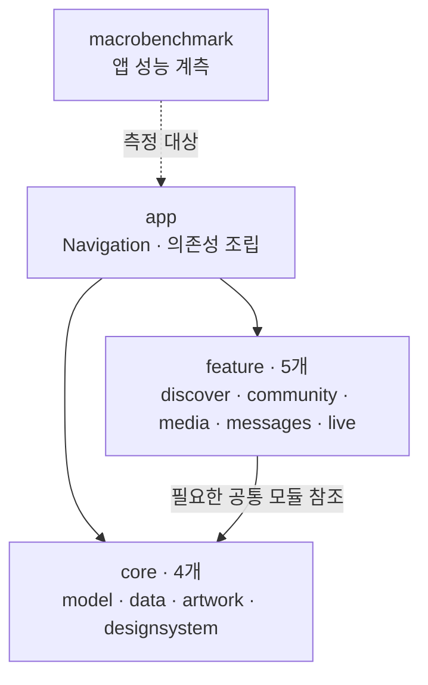
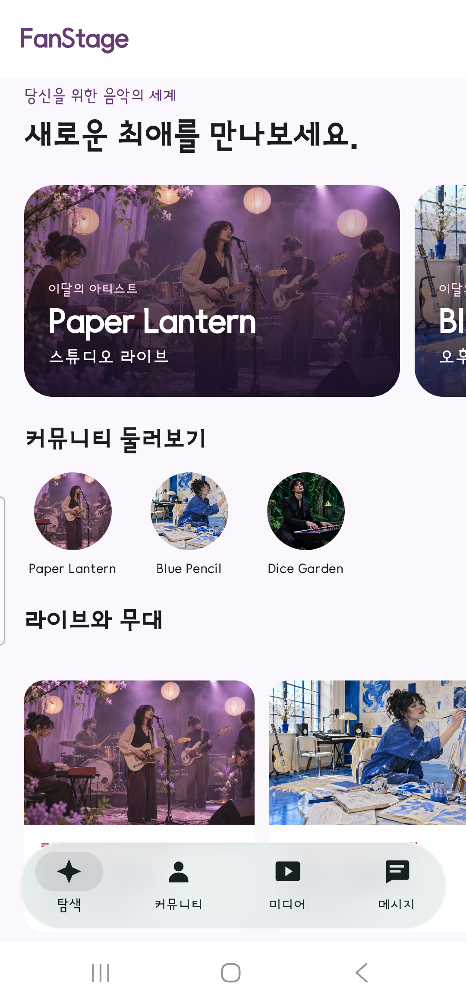
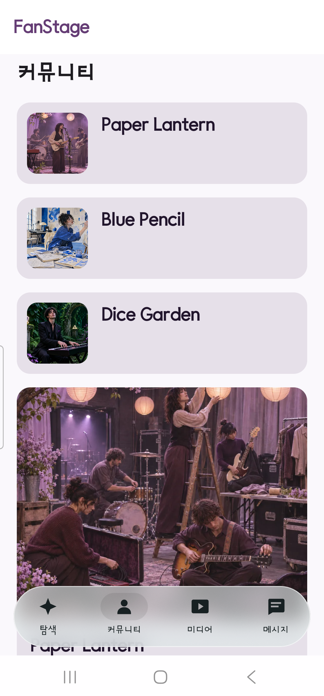
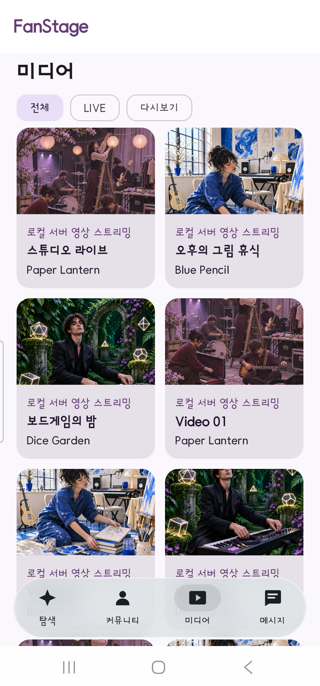
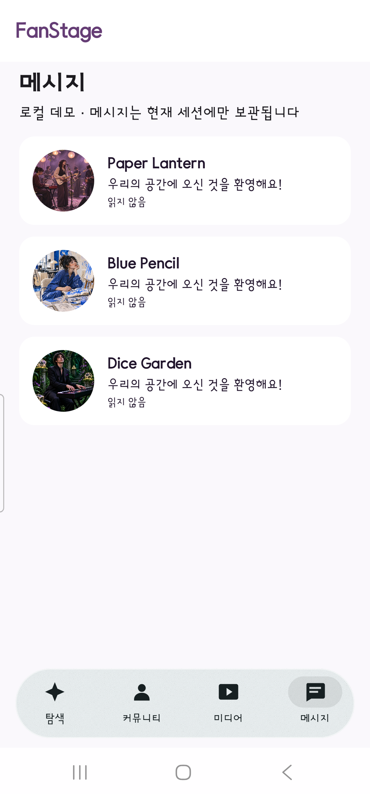
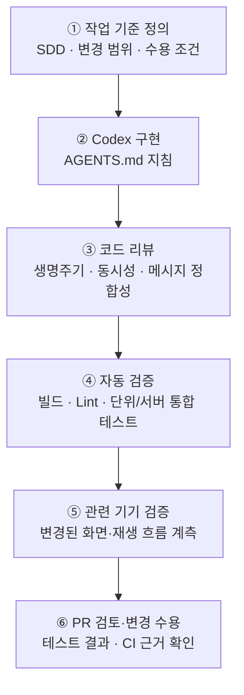

# FanStage

**Kotlin·Jetpack Compose로 구현한 Android 미디어·채팅 프로젝트**

FanStage는 가상의 팬 커뮤니티를 배경으로 영상 재생과 채팅을 구현한 Android 앱입니다. Media3 플레이어의 수명주기, WebSocket 메시지의 중복·누락 복구, Compose 멀티모듈 설계를 중점적으로 다뤘습니다. **Codex로 구현한 코드를 테스트와 리뷰로 검증하고, 결과를 PR·CI 기록에 연결한 개발 과정**도 함께 공개합니다.

**기술 스택:** Kotlin · Jetpack Compose · Coroutines/Flow · MVVM/UDF · Hilt · Media3 · WebSocket/HTTP · Spring Boot · PostgreSQL · GitHub Actions · Codex

## 아키텍처 한눈에 보기

기능별 화면과 공통 코드를 분리해 **11개 Gradle 모듈**로 구성했습니다. `app`은 화면 이동과 의존성 조립을 담당하고, 각 기능 모듈은 필요한 공통 모듈만 참조합니다.

기능 모듈이 `app`을 역참조하지 않도록 [모듈 의존성 검사](scripts/check-ux-module-boundaries.py)를 GitHub Actions에서 실행합니다. 실제 모듈별 의존 관계와 설계 이유는 [상세 아키텍처](docs/architecture.md) 및 [모듈 분리 PR #38](https://github.com/CodingBot000/fanstage-android-ai-harness/pull/38)에 기록했습니다.

## 앱 화면과 시연

Galaxy S22 Ultra(Android 16)에서 촬영한 화면입니다. 앱의 아티스트·게시물·대화는 가상 데이터이며, 영상 시연에는 로컬 서버의 사전 녹화 MP4를 사용했습니다.

| Discover | Community |
|:--:|:--:|
|  |  |
| Media | Messages |
|  |  |

[실기기 화면 탐색 · 13초](docs/portfolio/media/physical-20261108/navigation.mp4) · [영상 재생·설정 · 16초](docs/portfolio/media/physical-20261108/playback.mp4)

[LIVE 상세 화면](docs/evidence/physical-20261108/live.png) · [Replay 화면](docs/evidence/physical-20261108/replay.png) · [플레이어 설정](docs/evidence/physical-20261108/player-settings.png)

**시연 구성:** 기본 Replay 경로는 앱에 포함된 합성 HLS 영상을 재생합니다. Debug의 LIVE 룸 세 곳과 Media의 로컬 영상 항목은 로컬 서버의 녹화 MP4를 사용합니다. 채팅은 LIVE 화면에서 기본적으로 Fake 데이터로 동작하며, 개발 설정에서 로컬 WebSocket 서버로 전환해 실제 송수신·복구를 확인할 수 있습니다.

## 주요 구현과 문제 해결

### 1. Media3 재생과 생명주기 관리

합성 HLS·로컬 MP4 재생, 버퍼링·오류·재시도, 화질·자막·배속 설정과 전체 화면을 구현했습니다. 전체 화면으로 전환할 때는 같은 재생 세션을 유지하고, 화면을 벗어나면 Player·Listener·Surface를 정리합니다. 화면 회전·재진입과 재생 상태 변경을 Android 계측 테스트로 검증했습니다.

### 2. WebSocket 채팅의 중복·누락 복구

서버 저장 후 ACK가 유실되더라도 메시지 ID를 바꾸지 않고 재전송하도록 구성했습니다. 클라이언트는 전송 결과가 확인될 때까지 Pending 상태를 유지합니다. 서버 순번(`serverSequence`)으로 중복·역순 이벤트를 처리하고, 재연결할 때 HTTP 메시지 조회로 누락 구간을 보충합니다. 테스트용 TCP 프록시로 ACK 유실과 지연 응답을 재현했습니다.

### 3. Compose·MVVM 멀티모듈 구조

Discover·Community·Media·Messages·LIVE를 기능별로 분리하고 공통 모델·데이터·디자인 시스템·이미지 리소스를 별도 모듈로 구성했습니다. 앱은 총 **11개 Gradle 모듈**로 이루어져 있으며, Hilt로 Repository와 ViewModel을 주입합니다. 일반 ViewModel은 Activity 범위에서 공유하고 채팅은 룸별 수명주기를 유지합니다. ViewModel 상태 관리와 모듈 간 의존 방향은 테스트·검사 스크립트로 확인합니다.

**UI 재사용·화면 조립 사례 — [PR #70](https://github.com/CodingBot000/fanstage-android-ai-harness/pull/70):** 기존 `core:designsystem`의 간격·문자 표시 정책을 재사용하고, Media의 세 카드에서 반복되던 레이아웃을 `feature:media`의 `MediaArtworkCard`로 통합했습니다. `app`에서는 `FanStageAppShell`과 `FanStageNavHost`로 화면 구성 책임을 나눴습니다. 신규 범용 UI 모듈은 추가하지 않았고, 기존 Hilt/ViewModel 소유 범위를 유지했습니다. [재사용 기준·제외 이유](docs/adr/ADR-0005-ui-component-reuse.md) · [단계별 계약과 회귀 결과](docs/specs/ui-designsystem-refactoring.md).

### 4. AI 코딩 에이전트 제어와 코드 품질 검증

Codex에 작업을 맡기기 전에 **변경 범위·수용 기준을 정하고**, 구현 이후에는 **코드 리뷰와 실행한 테스트 결과**로 품질을 판단했습니다. 에이전트 지침(`AGENTS.md`)은 작업 방향을 안내하고, 빌드·Lint·단위/서버 통합 테스트는 Gradle과 GitHub Actions에서 실행합니다. Android 화면·재생 관련 계측은 변경 내용에 따라 로컬 기기에서 검증했습니다.

**검증 보완 사례 — [PR #47](https://github.com/CodingBot000/fanstage-android-ai-harness/pull/47):** 전체 화면 전환에서 이전 Surface의 첫 프레임을 새 출력의 성공으로 잘못 판단할 수 있음을 코드 리뷰에서 확인했습니다. 이전 PlayerView의 분리 순서를 조정하고 출력 객체를 확인하도록 테스트를 보완했습니다. 해당 PR에서 단위 테스트 56개와 로컬 API 36 계측 테스트 41개를 통과했습니다.

**Hilt 전환 검증 사례 — [PR #67](https://github.com/CodingBot000/fanstage-android-ai-harness/pull/67):** LIVE 재생 회귀 테스트가 실패하자 전환 이전 커밋에서도 같은 실패가 재현되는지 확인했습니다. 채팅 입력 시 UI 테스트 태그가 사라지는 문제를 실제 Player 상태 검사로 분리했고, 회전 후 일시정지 화면의 재생 버튼 문제도 수정했습니다. 실기기 선택 계측 39/39, 별도 Hilt 바인딩 1/1을 통과했으며 [실패부터 재검증까지의 기록](docs/specs/hilt-di-migration-verification.md)을 남겼습니다.

[AI 개발 제어·검증 상세 과정](docs/ai-development-workflow.md)

## 테스트 결과

| 검증 대상 | 기록된 결과 | 근거 |
|---|---|---|
| Media3 재생·설정·전체 화면 | 단위 56/56, 로컬 API 36 계측 41/41 통과 | [PR #47](https://github.com/CodingBot000/fanstage-android-ai-harness/pull/47) |
| 채팅 화면·로컬 서버 전환 | 단위 56/56, 로컬 API 36 계측 28/28 통과 | [PR #53](https://github.com/CodingBot000/fanstage-android-ai-harness/pull/53) |
| 키보드·입력 화면 | 단위 62/62, 로컬 API 36 관련 계측 24/24, 실기기 3/3 통과 | [PR #59](https://github.com/CodingBot000/fanstage-android-ai-harness/pull/59) |
| 기능별 모듈 분리 | 모듈 경계 검사·Android CI 통과 | [PR #38](https://github.com/CodingBot000/fanstage-android-ai-harness/pull/38) |
| Hilt DI·룸 수명주기 | 선택된 실기기 계측 39/39, 바인딩 대체 1/1, 격리 서버 Android 통합 1/1 PASS | [PR #67](https://github.com/CodingBot000/fanstage-android-ai-harness/pull/67) · [실행 이력](docs/specs/hilt-di-migration-verification.md) |
| WebSocket·PostgreSQL 복구 | 서버 통합·장애 주입 CI 통과 | [서버 CI](https://github.com/CodingBot000/fanstage-android-ai-harness/actions/runs/42240984227) |
| 검증 증거·품질 게이트 | 공개 XML/JSON 무결성 검사 및 PR `required-quality` PASS | [PR #69](https://github.com/CodingBot000/fanstage-android-ai-harness/pull/69) · [검증 증거와 한계](docs/evidence/verification/audit-20261108/README.md) |
| UI 공통화·화면 조립 리팩토링 | PR 기록상 API 36 에뮬레이터·실기기 UI 계측 각 43/43, Hilt 3/3; 시각적 전후 비교 `NOT_RUN` | [PR #70](https://github.com/CodingBot000/fanstage-android-ai-harness/pull/70) · [UI 설계 기록](docs/specs/ui-designsystem-refactoring.md) |

숫자는 링크된 **각 PR의 코드 버전에서 실행한 결과**입니다. Android 기기 계측은 로컬 에뮬레이터·실기기에서, 빌드·단위 테스트와 서버 통합 검사는 GitHub Actions에서 수행했습니다. [검증 환경과 테스트 항목](docs/verification.md) · [최종 검증 감사와 실행 증거](docs/evidence/verification/audit-20261108/audit-report.md)

## 실행 방법

JDK 17, Android SDK Platform 37, Build Tools 36.0.0을 준비합니다. 저장소 루트에서 다음 명령을 실행합니다.

~~~bash
cd android
./gradlew :app:assembleDebug :app:lintDebug testDebugUnitTest :core:data:test --no-daemon
~~~

Android Studio에서 `android/`를 열어 Debug 앱을 실행할 수 있습니다. **화면 탐색·Fake 데이터·Replay 합성 HLS**는 서버 없이 확인할 수 있습니다. LIVE 룸의 로컬 MP4 재생과 실제 WebSocket 채팅은 별도 로컬 서버를 실행합니다.

[Android 빌드 안내](android/README.md) · [로컬 서버 실행 안내](backend/chat-server/README.md)

## 상세 기술 문서

[현재 개발·검증 상태](docs/STATUS.md) · [아키텍처](docs/architecture.md) · [UI 재사용 ADR-0005](docs/adr/ADR-0005-ui-component-reuse.md) · [UI 리팩토링 SDD](docs/specs/ui-designsystem-refactoring.md) · [Hilt 설계 결정](docs/adr/ADR-0004-hilt-di-migration.md) · [AI 개발 제어·검증 과정](docs/ai-development-workflow.md) · [채팅 장애 주입 시나리오](docs/specs/failure-recovery.md) · [검증 결과](docs/verification.md) · [설계 결정](docs/adr/)

직접 작성한 코드·문서는 [MIT 라이선스](LICENSE)를 따르며, 외부 구성요소는 [제3자 라이선스 안내](THIRD_PARTY_NOTICES.md)를 따릅니다.
