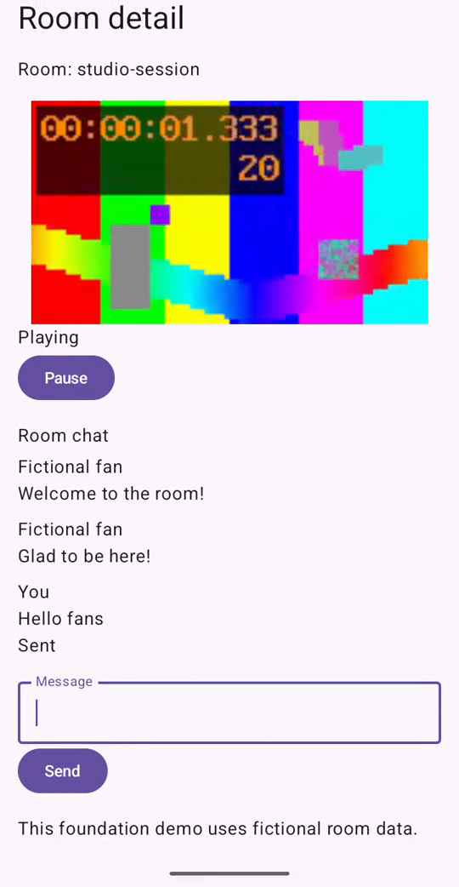

# FanStage — Android 영상·실시간 채팅 데모

FanStage는 **합성 HLS 영상과 채팅을 한 화면에서 다루는 Android 포트폴리오 프로젝트**입니다. 기본 실행은 로컬 합성 VOD와 가상 채팅을 사용합니다. 별도의 로컬 서버를 연결하면 PostgreSQL과 WebSocket/HTTP를 통한 실제 채팅 계약을 살펴볼 수 있습니다. 공개 방송이나 운영 서비스는 아닙니다.

**현재 상태: Portfolio Ready — v0.1 (소스·로컬 빌드 절차 제공, 공개 APK 없음)**. 기본 데모의 빌드·실행과 관련 CI·검증 근거를 확인했습니다. [최종 제출 범위와 남은 한계](docs/reviews/M8-final-readiness.md).

| 무엇을 만들었나 | 어떤 문제를 다뤘나 | 어떻게 확인했나 |
|---|---|---|
| Kotlin·Compose 룸 목록/상세, Media3 플레이어, Fake 채팅과 로컬 WebSocket 서버 | ACK 유실·중복·순서 역전, 누락 복구, 화면 이탈 시 자원 해제, 재생과 채팅의 독립성 | 단위 테스트, 로컬 서버 장애 주입, Android 에뮬레이터·실기기, CI 및 제한된 성능 실험 |

[](docs/portfolio/media/offline-demo.mp4)

[23초 무음 시연 영상 보기](docs/portfolio/media/offline-demo.mp4) · 에뮬레이터의 로컬 검증 전용 RC, 합성 영상과 Fake 채팅. 실제 네트워크 장애 장면은 포함하지 않습니다.

## 빠른 시작

JDK 17과 Android SDK platform 37/build-tools 36.0.0이 필요합니다. Android Studio에서 `android/`를 열거나 해당 디렉터리에서 실행합니다.

```sh
export ANDROID_HOME="$HOME/Library/Android/sdk" # SDK 경로에 맞게 변경
cd android
./gradlew :app:assembleDebug :app:lintDebug testDebugUnitTest --no-daemon
```

Android Studio의 `app` Debug 구성을 에뮬레이터에 실행하면 방 목록 → 상세 화면으로 진입할 수 있습니다. 영상은 프로젝트에 포함된 무음 합성 VOD이고, 채팅은 장치 내부의 Fake 서버입니다. Debug 빌드는 Android 개발용 서명을 사용하며 처음 빌드하는 환경에서는 Android 도구가 Debug 키를 생성할 수 있습니다. **공개 APK는 제공하지 않습니다.** 다른 OS 설정과 자세한 빌드 안내는 [Android README](android/README.md)를 참조하세요.

터미널에서 실행하려면 부팅된 **새 에뮬레이터**를 사용하고 `android/`에서 다음 명령을 실행합니다. `adb devices -l`에서 확인한 에뮬레이터 ID를 지정하세요. `install`은 같은 패키지가 이미 있으면 실패하며, 기존 앱을 교체하지 않습니다.

```sh
adb devices -l
export ANDROID_SERIAL=emulator-5554 # 실제 에뮬레이터 ID로 변경
adb -s "$ANDROID_SERIAL" install app/build/outputs/apk/debug/app-debug.apk
adb -s "$ANDROID_SERIAL" shell am start -n dev.fanstage.android/.MainActivity
```

Debug 상세 화면에는 로컬 서버 개발 설정이 먼저 나타납니다. 기본값은 `Offline fake`이며 아래로 스크롤하면 Fake 채팅 입력과 전송 버튼을 볼 수 있습니다. 위 시연 영상은 개발 설정이 없는 로컬 검증 전용 rcLocal 화면입니다.

실제 WebSocket 채팅은 별도 로컬 서버, Docker와 임시 테스트 자격값이 필요합니다. 실행·정리 절차는 [서버 README](backend/chat-server/README.md)에 있습니다. 개발 서버 선택은 Debug 전용이며 운영용 인증·TLS 구성이 아닙니다.

## 설계와 검증

- [아키텍처와 검증 상세](docs/portfolio/architecture-and-evidence.md) — 화면·ViewModel·Player·Chat·서버의 책임과 복구 경계.
- [실행 시연과 장애 주입 안내](docs/portfolio/demo-and-faults.md) — 화면에서 직접 확인 가능한 흐름과 별도 테스트의 장애·복구 증거.
- [포트폴리오 소개 문안](docs/portfolio/summary.md) — 구현과 검증 범위를 명시한 한 줄·상세 소개.
- [M5 장애 검증](docs/specs/M5-fault-recovery.md) — ACK 유실, 소켓 단절, 지연 snapshot과 테스트별 범위.
- [M6 성능 실험](docs/reviews/M6-002-ab-experiments.md) — 실기기 비교 조건과 결과. 두 변경은 되돌렸으며 제품 성능 개선은 입증하지 못했습니다.
- [M8 릴리스 후보 검증](docs/reviews/M8-001-release-candidate.md) — 로컬 검증 전용 RC와 서명·공개물 검토의 한계.
- CI 증거: [Android build/unit·에뮬레이터](https://github.com/CodingBot000/fanstage-android-ai-harness/actions/runs/42003790103), [PostgreSQL·WebSocket 장애 및 Android 연동](https://github.com/CodingBot000/fanstage-android-ai-harness/actions/runs/42003790152). 두 실행은 M8-001 PR head의 결과이며 실제 범위는 각 로그를 따릅니다.

## 한계와 현재 상태

원격 네트워크 LIVE, 실제 저메모리 종료, 장시간 heap, 실기기 네트워크 전환과 운영 인증·TLS는 검증하지 않았습니다. 합성 트래픽은 실제 동시접속자 수가 아닙니다. 실제 WebSocket CI에서 발생한 20초 타임아웃의 원인은 미확정이며 [PR #30 한정 위험 수용 기록](docs/reviews/M8-001-risk-exception-proposal.md)에 재조사 조건을 남겼습니다. 공개 배포 서명은 미결정이며, 시연 영상의 제3자 UI 사용 권리 등 [라이선스 감사의 미확인 항목](docs/reviews/M8-license-audit.md)이 남아 있습니다.

현재 작업은 [STATUS](docs/STATUS.md), 전체 범위는 [MASTER_PLAN](docs/MASTER_PLAN.md)을 확인하세요.

## 라이선스

프로젝트에서 직접 작성한 코드와 문서는 [MIT License](LICENSE)를 따릅니다. Gradle Wrapper와 그 밖의 제3자 구성요소는 각자의 조건이 적용되며, 포함 범위와 미확인 시연 화면 권리는 [제3자 고지](THIRD_PARTY_NOTICES.md)와 [라이선스 감사](docs/reviews/M8-license-audit.md)를 확인하세요.
