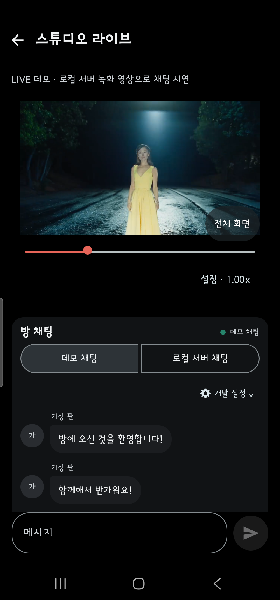
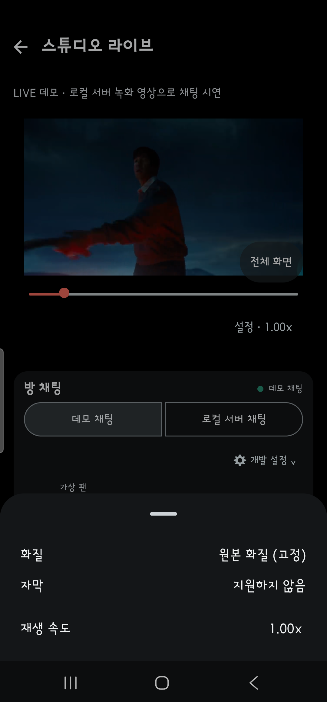
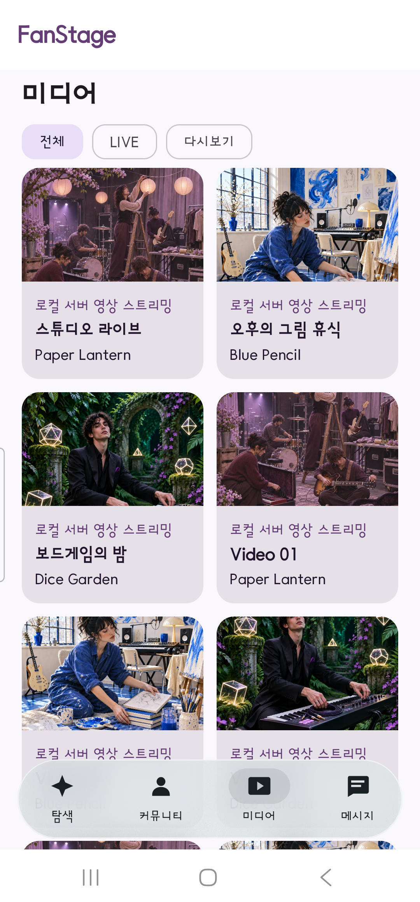
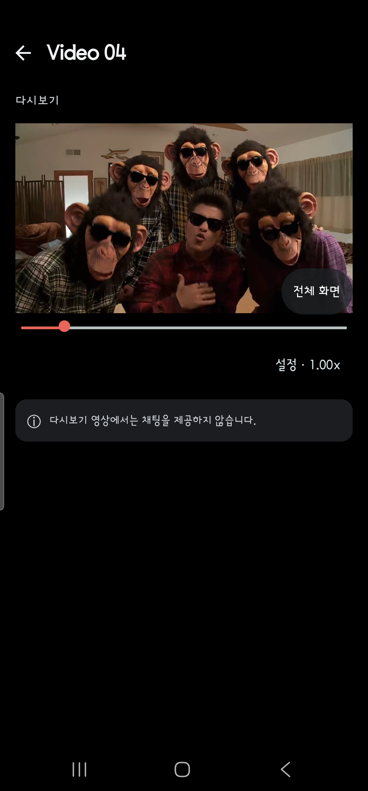
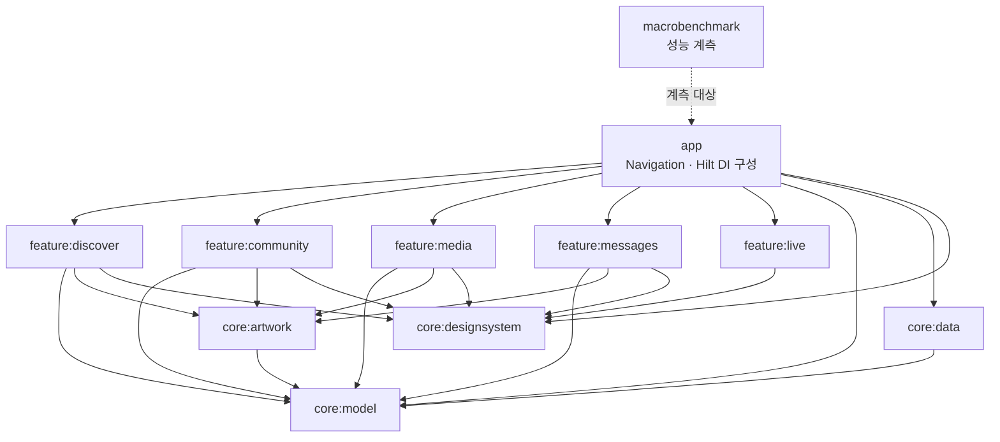

# FanStage

**Android Native 팬 커뮤니티 포트폴리오 | Kotlin · Jetpack Compose · Media3 · WebSocket**

FanStage는 **영상 재생과 실시간 채팅을 함께 다루는 Android 앱**입니다. Discover, Community, Media, Messages, LIVE 화면을 구현했으며, 특히 **플레이어 수명주기, 채팅 메시지 정합성, 연결 복구**를 기술 과제로 다뤘습니다.

**프로젝트 및 담당 범위:** 개인 개발 프로젝트(2026년 11월). 요구사항·설계·수용 기준을 정의하고, Codex의 코드 작성·수정 결과를 리뷰한 뒤 테스트·CI 근거를 확인해 변경을 수용했습니다.

**주요 기술:** Kotlin · Compose · Coroutines/Flow · MVVM/UDF · Hilt · Media3 ExoPlayer · WebSocket/HTTP · Spring Boot · PostgreSQL · GitHub Actions · Codex

## 구현 기능

| 화면 | 구현 기능 | 데이터·실행 범위 |
|---|---|---|
| **Discover · Community** | 팬 콘텐츠·게시물 탐색과 댓글 입력 | 가상 콘텐츠·Fake Repository |
| **Messages** | DM 화면, 대화별 입력 초안 보존과 전송 접수 처리 | Fake Repository (실제 서버 ACK 아님) |
| **Media · Replay** | 영상 목록, HLS 재생, 전체 화면 및 플레이어 설정 | 앱 내 합성 HLS VOD 또는 개발용 로컬 MP4 |
| **LIVE** | 영상 재생과 채팅 동시 표시, 메시지 전송·재연결·누락 복구 | 로컬 MP4 + Fake 채팅 또는 로컬 WebSocket/HTTP |

실제 상용 서비스가 아닌 **재현 가능한 포트폴리오 환경**입니다. 영상과 채팅의 실행 조건은 아래 시연 및 [Android 실행 안내](android/README.md#시연-경로)에 구분했습니다.

## 핵심 화면과 시연

| LIVE · 채팅 | 영상 재생 설정 |
|:--:|:--:|
|  |  |
| Media 화면 | Replay 플레이어 |
|  |  |

**시연 영상:** [영상 재생·설정 (16초)](docs/portfolio/media/physical-20261108/playback.mp4) · [앱 화면 탐색 (13초)](docs/portfolio/media/physical-20261108/navigation.mp4)

**서버 없이 재현하는 경로 (Debug 앱)**

1. 앱 실행 → 하단 **Media** 탭 선택
2. 목록에서 **Synthetic HLS** 카드 선택
3. **Replay** 화면에서 앱에 포함된 합성 HLS 영상을 재생하고 플레이어 조작·전체 화면을 확인

LIVE 영상에는 개발용 로컬 MP4가 필요합니다. 채팅은 기본 Fake 모드로 확인하거나 로컬 WebSocket 서버로 연결할 수 있습니다. 자세한 조건은 [실행 안내](android/README.md#시연-경로)를 참고하세요.

## AI 코딩 에이전트 활용과 품질 통제

**사람이 설계하고 검증 기준을 정했으며, Codex는 코드 구현·수정에 사용했습니다.** 에이전트의 완료 보고만으로 성공을 판단하지 않고 실제 실행 결과와 변경 내용을 확인했습니다.

**작업 흐름:** 요구사항·수용 조건 정의(SDD/ADR) → Codex 구현·수정 → 빌드·테스트·기기 검증 → 코드 변경과 PR 결과 검토 → 변경 수용

| 통제 지점 | 실제 적용 |
|---|---|
| **작업 범위** | 기능별 정상·오류 시나리오와 완료 조건을 정의하고, `AGENTS.md`로 범위 밖 변경·테스트 무력화를 금지 |
| **변경 검토** | Player/Surface 수명, Coroutine 취소, 채팅 ACK·순번·중복 등 기능별 위험을 코드와 테스트로 대조 |
| **자동 검증** | Gradle 빌드·Lint·단위 테스트·모듈 경계 검사, PostgreSQL/WebSocket 통합 테스트, 변경 경로별 PR `required-quality` 체크 |
| **기기 검증·수용** | 화면·재생·입력 변경은 로컬 에뮬레이터/실기기 계측 결과를 별도로 확인; 미실행 항목은 PASS로 간주하지 않음 |

이 프로젝트의 검증 대상은 **AI 모델의 답변 품질이 아니라 AI가 생성·수정한 Android 코드의 동작과 회귀**입니다. 구체적인 작업 지침과 판단 사례는 [AGENTS.md](AGENTS.md) · [AI 개발·검증 과정](docs/ai-development-workflow.md) · [검증 정책](docs/specs/ci-required-quality-policy.md)에 기록했습니다.

## 주요 기술 문제와 해결

### 1. ACK 유실 시 채팅 메시지의 중복을 어떻게 막을까?

**문제:** 서버가 메시지를 저장해도 ACK가 유실되면 클라이언트는 성공 여부를 알 수 없습니다. 단순 실패 처리나 새 ID로 재전송하면 중복이 발생할 수 있습니다.

**대응:** 결과가 불확실한 전송은 Pending으로 유지하고 동일한 `clientMessageId`로 재시도합니다. 서버는 멱등 키로 중복 저장·방송을 방지하고, 클라이언트는 `serverSequence`와 HTTP 조회로 순서·누락을 복구합니다.

**근거:** [ChatViewModel](android/feature/live/src/main/kotlin/dev/fanstage/android/feature/live/chat/ChatViewModel.kt) · [메시지 정합성 처리](android/feature/live/src/main/kotlin/dev/fanstage/android/feature/live/chat/ChatTimelineStore.kt) · [ACK 유실 장애 주입 테스트](backend/chat-server/tests/m5_faults.py) · [채팅 설계](docs/specs/realtime-chat.md)

### 2. 전체 화면 전환 중 Media3 화면 출력은 어떻게 관리할까?

**문제:** Player 재생 세션과 PlayerView·Surface의 수명은 다릅니다. 이전 출력의 첫 프레임 이벤트를 새 화면의 성공으로 잘못 판정할 수 있었습니다.

**대응:** 기존 View 연결을 해제한 뒤 새 View에 연결하고 출력 세대(`generation`)를 구분했습니다. TextureView를 사용하며 화면 종료 시 Player·Listener·Surface 정리 책임을 명확히 했습니다.

**근거:** [PlayerView 연결·해제](android/feature/live/src/main/kotlin/dev/fanstage/android/feature/live/Media3PlayerController.kt) · [기기 계측 테스트](android/app/src/androidTest/kotlin/dev/fanstage/android/PlayerSettingsTest.kt) · [설계 결정](docs/adr/ADR-0002-player-lifecycle.md)

### 3. AI가 수정한 코드의 테스트 실패는 어떻게 판단할까?

**문제:** Hilt 전환 중 LIVE 재생 회귀 테스트가 실패했지만, DI 변경으로 인한 제품 결함이라고 단정할 근거가 없었습니다.

**대응:** 변경 이전 커밋에서도 실패를 재현해 원인을 분리했습니다. 키보드 표시 때문에 사라지는 UI 태그 대신 실제 Player 상태·동일성을 확인하도록 테스트를 보강하고, 별도로 확인된 회전 후 일시정지 버튼 표시 문제를 수정했습니다.

**근거:** [실패 분석과 재검증](docs/specs/hilt-di-migration-verification.md) · [수정 PR #67](https://github.com/CodingBot000/fanstage-android-ai-harness/pull/67)

## Android 아키텍처

**11개 Gradle 모듈:** 앱 진입점 1개, 기능 5개, 공통 4개, 성능 계측 1개로 분리했습니다. `app`은 공통 화면 틀·루트 Navigation·Hilt DI 구성을 맡고, 각 Feature는 자신의 화면 목적지와 인자를 관리합니다. 기능 사이의 이동은 `app`에서 연결합니다.



**도식 읽는 법:** 실선은 제품 모듈 간 직접 Gradle 의존성, 점선은 `macrobenchmark`가 `app`을 계측하는 대상 관계입니다. 기능 모듈끼리는 직접 의존하지 않으며, Gradle이 평가한 의존성과 API 공개 범위를 CI에서 검사합니다.

**[Android 아키텍처 상세 보기 — 기능별 Navigation·Hilt DI·Compose 상태 관리·채팅·미디어 설계](docs/architecture.md)**

**최근 멀티모듈 개선:** 기능별 Navigation 등록과 단위 테스트를 각 Feature로 옮기고, Discover·Media의 카탈로그 조회와 Community·Messages의 아티스트 조회를 분리했습니다. Gradle이 평가한 의존성으로 모듈 경계를 검사합니다. 기존 탭 전환과 ViewModel 수명은 유지했습니다. [변경·검증 근거](docs/verification.md#2026-11-23-android-멀티모듈-리팩토링)

Compose는 ViewModel의 `UiState`를 구독합니다. 채팅은 **룸별 ViewModel**이 연결·전송 수명을 관리하고, 별도 저장소가 순번·중복·Pending을 처리하도록 분리했습니다. DM·댓글 초안은 각각의 화면 목적지에서 관리해 회전·Activity 재생성 중 유지하고, 해당 목적지가 최종 제거되면 비웁니다. OS 프로세스 종료 이후의 초안 복원은 지원하지 않습니다.

**구현·검증 근거:** [모듈 경계 자동 검사](scripts/check-ux-module-boundaries.py) · [최근 리팩토링 완료 기록](docs/STATUS.md)

## 검증 결과

| 영역 | 확인 범위 |
|---|---|
| **Android 로컬 기기** | 에뮬레이터·Galaxy 실기기에서 영상 재생, 전체 화면·회전, 채팅·입력 UI, Hilt 바인딩 등 선택 시나리오 계측 |
| **서버 통합** | PostgreSQL·WebSocket 통합, ACK 유실·재전송·연결 복구 시나리오 |
| **Android CI** | 빌드·Lint·단위 테스트·모듈 경계 검사 및 일반/Hilt 계측 APK **컴파일** |
| **PR 품질 게이트** | 변경 유형별 체크를 `required-quality`로 집계하고 검증 증거 무결성 검사 |

**계측 APK 컴파일은 기기 계측 실행과 다릅니다.** 실행 결과는 시점·커밋·기기별로 기록했으며, 최근 모든 변경에 대해 실기기·장시간 누수·정량 성능을 재측정했다고 주장하지 않습니다. 결과와 미실시 범위는 [검증 기록](docs/verification.md) · [테스트 매트릭스](docs/test-matrix.md) · [Android CI](.github/workflows/android-ci.yml) · [서버 CI](.github/workflows/m4-integration.yml)에서 확인할 수 있습니다.

## 실행 방법

JDK 17, Android SDK Platform 37, Build Tools 36.0.0을 준비하고 Android Studio에서 `android/` 폴더를 열어 Debug 앱을 실행합니다.

```bash
cd android
./gradlew :app:assembleDebug :app:lintDebug testDebugUnitTest :core:data:test --no-daemon
```

기본 화면 탐색과 **Media → Synthetic HLS → Replay**는 서버 없이 시연할 수 있습니다. 로컬 MP4 재생 및 실제 WebSocket 채팅 환경은 [Android 실행 안내](android/README.md) · [백엔드 실행 안내](backend/chat-server/README.md)를 참고하세요.

직접 작성한 코드·문서는 [MIT 라이선스](LICENSE)를, 외부 구성요소는 [제3자 라이선스 안내](THIRD_PARTY_NOTICES.md)를 따릅니다.
