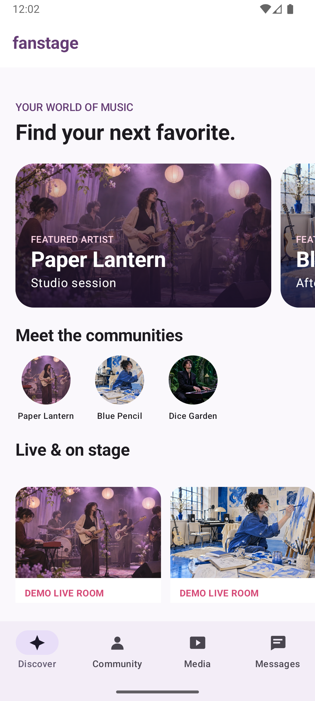
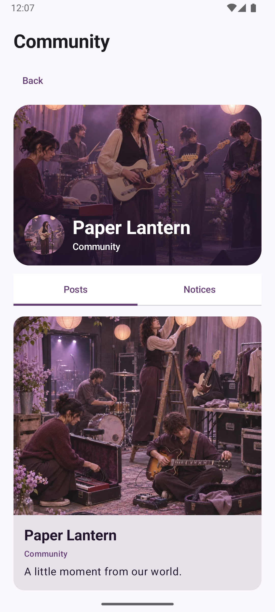
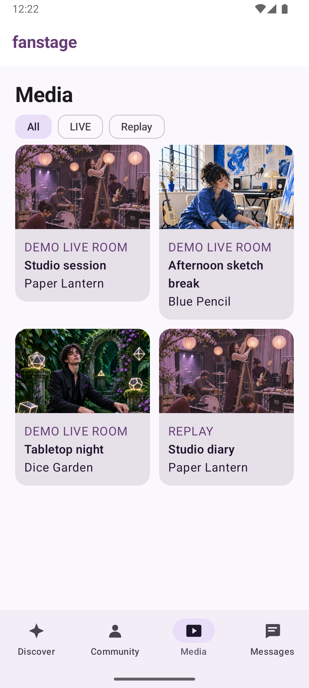
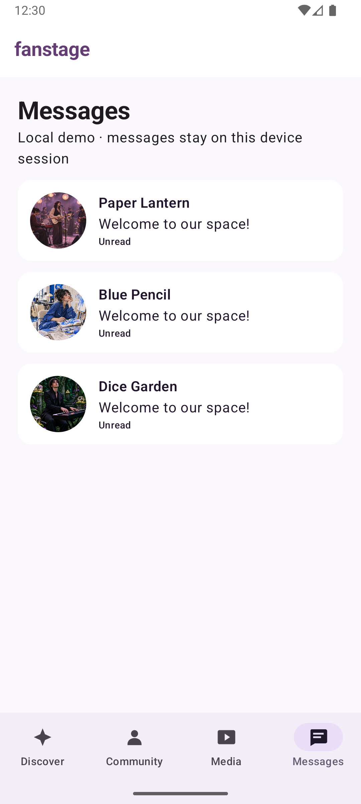
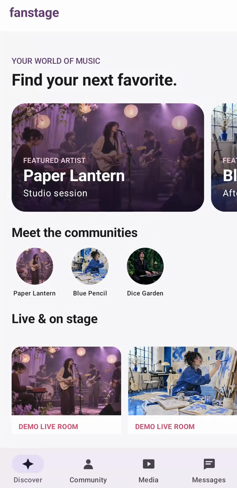

# FanStage — Native Android Fan Experience

FanStage는 **Kotlin·Jetpack Compose로 구현한 가상의 아티스트 팬 커뮤니티 Android 포트폴리오**입니다. Discover·Community·Media·Messages를 탐색하고, 기존 Media3 HLS 재생과 채팅 화면으로 이어집니다. 기본 데이터와 DM·좋아요·댓글은 로컬 Fake이며, 실제 WebSocket/HTTP·Spring Boot·PostgreSQL 연동은 별도의 로컬 개발 서버에서 검증했습니다. 실제 방송·운영 팬 서비스는 아닙니다.

**현재 상태: Portfolio Ready — 프리미엄 Compose UX + 11개 모듈**. 기본 기술 코어 [PR #36](https://github.com/CodingBot000/fanstage-android-ai-harness/pull/36)에 이어, 비주얼 개편·기능별 모듈 분리 [PR #38](https://github.com/CodingBot000/fanstage-android-ai-harness/pull/38)가 병합됐습니다. 공개 APK 없이 소스와 로컬 빌드 절차를 제공합니다. [최종 아키텍처 기록](docs/specs/ARCH-001-feature-modularization.md), [v0.1 기술 코어의 검증·한계](docs/reviews/M8-final-readiness.md).

## v0.1 핵심 구현과 검증

- **플레이어:** Media3 HLS와 로컬 HTTP MP4 VOD, 실제 트랙 기반 화질·자막 선택, 배속 및 Dialog 전체 화면. 화면 소유 세션과 읽기 전용 UI 상태를 유지하며 전체 화면에서 같은 플레이어를 사용합니다. [PLAYER-001 SDD](docs/specs/PLAYER-001-player-settings-fullscreen.md) · [설계 결정](docs/adr/ADR-0010-player-settings-fullscreen.md).
- **화면과 채팅:** Kotlin·Jetpack Compose 멀티 모듈의 LIVE/Replay UI, Fake 채팅 및 별도 로컬 WebSocket 서버의 ACK·중복·순서·누락 복구를 구현했습니다.
- **근거:** PLAYER-001 최종 PR 기준 로컬 단위 56/56과 API 36 전용 AVD 계측 41/41 PASS. 같은 PR의 [Android CI](https://github.com/CodingBot000/fanstage-android-ai-harness/actions/runs/42240984158)와 [서버 CI](https://github.com/CodingBot000/fanstage-android-ai-harness/actions/runs/42240984227)는 PASS이며 원격 에뮬레이터 및 서버 Android 단계는 **SKIPPED**입니다. 이 수치는 해당 실행 범위와 소스 기준입니다.
- **PLAYER-002 PiP: DEFERRED — v0.2 Candidate.** main에 포함되지 않은 로컬 실험입니다. API 30 실제 시스템 닫기에서 release가 관측됐지만, 별도의 빠른 강제 스택 제거에서는 ExoPlayer가 15초 내 해제되지 않는 P1이 미해결입니다. 이 실험을 v0.1 완료 기능으로 주장하지 않습니다.

[합성 자막 화면](docs/evidence/player-001/caption.png) · [세로 영상](docs/evidence/player-001/portrait.png) · [회전 후 화면](docs/evidence/player-001/post-rotation.png). 캡처와 데모의 에뮬레이터 UI·폰트 및 Git 이력의 과거 키보드 구간은 [권리 감사](docs/reviews/M8-license-audit.md)에 남은 한계가 있습니다.

## Compose 화면 미리보기

UX-007~011에서 에뮬레이터로 캡처한 화면입니다. 가상 아티스트·합성 콘텐츠와 로컬 Fake 데이터로 구성했습니다. 해당 [PR #38](https://github.com/CodingBot000/fanstage-android-ai-harness/pull/38)의 [Android CI](https://github.com/CodingBot000/fanstage-android-ai-harness/actions/runs/42066922626), [실제 WebSocket CI](https://github.com/CodingBot000/fanstage-android-ai-harness/actions/runs/42066922691) 및 Codex 독립 리뷰는 최종 PR head에서 PASS했습니다.

| Discover Home | Community Feed |
|:--:|:--:|
|  |  |
| Media | Messages |
|  |  |

[LIVE 데모](docs/evidence/ux-010/live.png) · [Replay](docs/evidence/ux-010/replay.png) · [Post](docs/evidence/ux-009/post.png) · [Conversation](docs/evidence/ux-011/conversation.png) · 모든 아티스트와 콘텐츠는 가상입니다. 과거 UX-006 화면은 [기존 기록](docs/specs/UX-006-integration.md)에 보존합니다.

| 무엇을 만들었나 | 어떤 문제를 다뤘나 | 어떻게 확인했나 |
|---|---|---|
| Compose 4개 메인 탭과 커뮤니티·게시물·대화·LIVE/Replay 상세, Media3 플레이어, Fake 및 실제 로컬 WebSocket 채팅 | 여러 화면의 상태·탭 복원, ACK 유실·중복·순서 역전·누락 복구, 화면 이탈 시 자원 해제 | UX 계측 14건 및 서버 장애 주입, CI·에뮬레이터·실기기에서 수행한 범위별 검증 |

### UX 화면 시연

[](docs/portfolio/media/ux-premium-demo.mp4)

[16초 무음 시연 보기](docs/portfolio/media/ux-premium-demo.mp4) · 전용 에뮬레이터에서 Discover·Community·Media·Messages 탭을 캡처했습니다. 실제 방송이나 서버 전달 장면은 포함하지 않습니다.

### 기존 LIVE/Chat 코어 시연 (UX 확장 이전 영상)

[](docs/portfolio/media/offline-demo.mp4)

[23초 무음 시연 영상 보기](docs/portfolio/media/offline-demo.mp4) · 에뮬레이터의 로컬 검증 전용 RC, 합성 영상과 Fake 채팅. 실제 네트워크 장애 장면은 포함하지 않습니다.

## 빠른 시작

JDK 17과 Android SDK platform 37/build-tools 36.0.0이 필요합니다. Android Studio에서 `android/`를 열거나 해당 디렉터리에서 실행합니다.

```sh
export ANDROID_HOME="$HOME/Library/Android/sdk" # SDK 경로에 맞게 변경
cd android
./gradlew :app:assembleDebug :app:lintDebug testDebugUnitTest :core:data:test --no-daemon
```

Android Studio의 `app` Debug 구성을 에뮬레이터에 실행하면 Discover 홈에서 Community·Media·Messages를 탐색하고 LIVE/Replay 상세로 진입할 수 있습니다. 영상은 프로젝트에 포함된 무음 합성 VOD이고, 채팅은 장치 내부의 Fake 서버입니다. Debug 빌드는 Android 개발용 서명을 사용하며 처음 빌드하는 환경에서는 Android 도구가 Debug 키를 생성할 수 있습니다. **공개 APK는 제공하지 않습니다.** 다른 OS 설정과 자세한 빌드 안내는 [Android README](android/README.md)를 참조하세요.

터미널에서 실행하려면 부팅된 **새 에뮬레이터**를 사용하고 `android/`에서 다음 명령을 실행합니다. `adb devices -l`에서 확인한 에뮬레이터 ID를 지정하세요. `install`은 같은 패키지가 이미 있으면 실패하며, 기존 앱을 교체하지 않습니다.

```sh
adb devices -l
export ANDROID_SERIAL=emulator-5554 # 실제 에뮬레이터 ID로 변경
adb -s "$ANDROID_SERIAL" install app/build/outputs/apk/debug/app-debug.apk
adb -s "$ANDROID_SERIAL" shell am start -n dev.fanstage.android/.MainActivity
```

Debug 상세 화면에는 로컬 서버 개발 설정이 먼저 나타납니다. 기본값은 `Offline fake`이며 아래로 스크롤하면 Fake 채팅 입력과 전송 버튼을 볼 수 있습니다. 위 시연 영상은 개발 설정이 없는 로컬 검증 전용 rcLocal 화면입니다.

실제 WebSocket 채팅은 별도 로컬 서버, Docker와 임시 테스트 자격값이 필요합니다. 실행·정리 절차는 [서버 README](backend/chat-server/README.md)에 있습니다. 개발 서버 선택은 Debug 전용이며 운영용 인증·TLS 구성이 아닙니다.

## 설계와 검증

현재 병합된 `main`은 `:app`의 Navigation·AppContainer를 중심으로 `:feature:discover`, `:feature:community`, `:feature:media`, `:feature:messages`, 기존 `:feature:live`와 `:core:model`, `:core:data`, `:core:artwork`, `:core:designsystem`으로 구성합니다. [모듈 경계 및 검증 결과](docs/specs/ARCH-001-feature-modularization.md)을 참조하세요.

- [UX-001~006 통합 기록](docs/specs/UX-006-integration.md) — 확장 화면·로컬 계측 14건·서버 연동·남은 한계.
- [UX 통합 최종 PR #36](https://github.com/CodingBot000/fanstage-android-ai-harness/pull/36) — Android·서버 CI PASS와 독립 리뷰 P2 두 건 수정 및 해결 기록.
- [아키텍처와 검증 상세](docs/portfolio/architecture-and-evidence.md) — v0.1 Player·Chat·서버의 책임과 복구 경계.
- [실행 시연과 장애 주입 안내](docs/portfolio/demo-and-faults.md) — 화면에서 직접 확인 가능한 흐름과 별도 테스트의 장애·복구 증거.
- [포트폴리오 소개 문안](docs/portfolio/summary.md) — 구현과 검증 범위를 명시한 한 줄·상세 소개.
- [M5 장애 검증](docs/specs/M5-fault-recovery.md) — ACK 유실, 소켓 단절, 지연 snapshot과 테스트별 범위.
- [M6 성능 실험](docs/reviews/M6-002-ab-experiments.md) — 실기기 비교 조건과 결과. 두 변경은 되돌렸으며 제품 성능 개선은 입증하지 못했습니다.
- [M8 릴리스 후보 검증](docs/reviews/M8-001-release-candidate.md) — 로컬 검증 전용 RC와 서명·공개물 검토의 한계.
- CI 증거: [Android build/unit·에뮬레이터](https://github.com/CodingBot000/fanstage-android-ai-harness/actions/runs/42003790103), [PostgreSQL·WebSocket 장애 및 Android 연동](https://github.com/CodingBot000/fanstage-android-ai-harness/actions/runs/42003790152). 두 실행은 M8-001 PR head의 결과이며 실제 범위는 각 로그를 따릅니다.

## 한계와 현재 상태

원격 네트워크 LIVE, 실제 저메모리 종료, 장시간 heap, 실기기 네트워크 전환과 운영 인증·TLS는 검증하지 않았습니다. 합성 트래픽은 실제 동시접속자 수가 아닙니다. 실제 WebSocket CI에서 발생한 20초 타임아웃의 원인은 미확정이며 [PR #30 한정 위험 수용 기록](docs/reviews/M8-001-risk-exception-proposal.md)에 재조사 조건을 남겼습니다. 공개 배포 서명은 미결정이며, 시연 영상의 제3자 UI 사용 권리 등 [라이선스 감사의 미확인 항목](docs/reviews/M8-license-audit.md)이 남아 있습니다.

현재 작업은 [STATUS](docs/STATUS.md), 전체 범위는 [MASTER_PLAN](docs/MASTER_PLAN.md)을 확인하세요.

## 라이선스

프로젝트에서 직접 작성한 코드와 문서는 [MIT License](LICENSE)를 따릅니다. Gradle Wrapper와 그 밖의 제3자 구성요소는 각자의 조건이 적용되며, 포함 범위와 미확인 시연 화면 권리는 [제3자 고지](THIRD_PARTY_NOTICES.md)와 [라이선스 감사](docs/reviews/M8-license-audit.md)를 확인하세요.

### Local MP4 VOD demonstration

The Debug emulator can play seven privately supplied local MP4 files over HTTP Progressive VOD while retaining the synthetic HLS demo. This is prerecorded VOD, not live HLS or adaptive streaming. See [local server setup](backend/chat-server/README.md#optional-local-mp4-vod); video files are not included in the repository.
