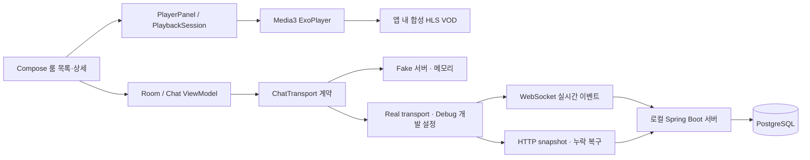

# 아키텍처와 검증 근거

## 경계와 소유권

- `:app`은 Navigation과 화면별 ViewModel 생성을 담당합니다. `:feature:live`는 화면, Player 수명, 채팅 상태·전송 계층을 갖고, `:core:model`은 공통 모델을 제공합니다.
- `PlayerPanel`은 lifecycle에 맞춰 재생을 제어하고 화면에서 제거될 때 listener와 Player를 해제합니다. 채팅 연결과 재생은 독립적으로 동작합니다. 전체 heap 누수 부재를 증명한 것은 아닙니다.
- `ChatViewModel`은 사용자 메시지를 Pending으로 표시합니다. ACK나 확인된 이벤트를 처리하며 중복과 순서를 관리합니다. 알 수 없는 전송 결과를 성공으로 확정하지 않고 동일 ID로 재시도할 수 있습니다.
- Real transport는 WebSocket 실시간 이벤트와 HTTP snapshot을 사용합니다. 서버 등록과 snapshot 경계에서 이벤트가 겹칠 수 있으므로 ViewModel이 순서와 중복을 조정합니다. 로컬 개발 서버이며 공개 운영 배포가 아닙니다.
- Fake 경로의 활성 룸과 가상 서버는 총 1,000개 논리 메시지를 보관하고 화면에 최대 500개를 표시합니다. 입력은 메시지당 1,000 Unicode 코드포인트입니다. 세부 계약은 [M3 SDD](../specs/M3-fake-chat.md), [M4 SDD](../specs/M4-real-chat.md)에 있습니다.

## 장애를 어떻게 확인했나

| 시나리오 | 관찰된 증거 | 범위 |
|---|---|---|
| ACK와 발신자 echo 유실 | Android ViewModel의 불확실 Pending 및 같은 ID 재전송, 서버 중복 방지 | 격리된 서버·프록시와 에뮬레이터. [M5 NET-02](../specs/M5-fault-recovery.md) |
| 연결 단절과 복구 | 테스트 서버 단절 후 재구독·snapshot, Android 소켓 취소 후 10초 재접속 대기 | 같은 실행에서의 실제 10초 물리 네트워크 단절은 NOT_RUN. [M5 NET-01](../specs/M5-fault-recovery.md) |
| snapshot 지연과 순서 | 늦은 HTTP snapshot과 앞서 도착한 live 이벤트가 합쳐짐 | 통합 테스트 fixture. [M5 NET-05](../specs/M5-fault-recovery.md) |
| 재생 오류와 분리 | 로컬 fixture segment 오류 후 재시도, 채팅 실패 중 재생 유지 | 로컬 fixture·테스트 전용 주입. [M5 MEDIA-01](../specs/M5-fault-recovery.md) |
| 화면 종료 | Player 생성/해제, listener 회수와 테스트 경로의 채팅 Job·transport 종료 | 제한된 횟수의 관측. 장시간 heap 및 전체 누수 부재는 NOT_RUN. [M8 보고서](../reviews/M8-001-release-candidate.md) |

[Android PR CI](https://github.com/CodingBot000/fanstage-android-ai-harness/actions/runs/42003790103)와 [서버·Android 연동 PR CI](https://github.com/CodingBot000/fanstage-android-ai-harness/actions/runs/42003790152)는 각각 M8-001 최종 PR head의 결과입니다. 최근 결과와 최초 실패·일회성 예외는 [검증 보고서](../reviews/M8-001-release-candidate.md)와 [승인 기록](../reviews/M8-001-risk-exception-proposal.md)을 따릅니다.

## 성능: 결과와 한계

동일 SM-G975N / Android 12 / 60Hz에서 각 실행 10회씩 측정한 [M6 보고서](../reviews/M6-002-ab-experiments.md)의 일부입니다. APK·소스와 측정 조건은 원 보고서에 기록되어 있습니다.

| 실험과 지표 | 변경 전 | 변경 후 | 판단 |
|---|---:|---:|---|
| A: fixture의 동기 emit → ViewModel 수용 시간, 반복 평균의 중앙값 | 0.585614ms | 0.504111ms | 감소 관찰. 실제 네트워크 또는 화면 표시 지연이 아니며, 대조군 프레임 회귀 가능성으로 변경을 되돌림 |
| A: Player 일시정지 대조군 프레임 CPU 중앙값의 중앙값 | 7.8409ms | 12.1808ms | 악화 관찰, 원인 미확정. 개선을 주장하지 않음 |
| B: cold startup TTID 중앙값 | 523.08ms | 567.00ms / 재시험 593.15ms | 두 변경 후 실행에서 느려져 변경을 되돌림 |

원본 Perfetto trace와 장치 정보는 개인정보 가능성 때문에 공개하지 않습니다. 로컬 경로와 manifest 해시는 원 보고서에 있습니다. M7 이후 UI에 이전 baseline을 적용해 성능 향상으로 주장하지 않습니다.

## 개발 방식

기능별 SDD와 ADR로 계약을 정리하고, Codex가 구현·검증한 뒤 독립 리뷰와 CI·실기기 증거를 연결했습니다. 실패와 NOT_RUN도 남깁니다. 예를 들어 M8의 최초 WebSocket CI 타임아웃은 원인을 특정하지 못했고, 사용자가 해당 PR에 한해 위험 수용 예외를 승인했습니다. [ADR-0005](../adr/ADR-0005-fast-track.md), [예외 기록](../reviews/M8-001-risk-exception-proposal.md)을 참조하세요.
